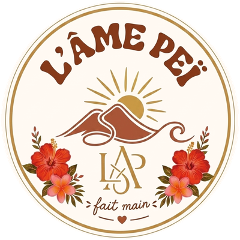

<p align="center">
  
</p>

<h1 align="center">L'ÂME PEÏ</h1>
<p align="center"><em>Tongs perlées fait main · La Réunion</em></p>

---

## Présentation

**L'ÂME PEÏ** est une jeune marque réunionnaise de tongs personnalisées : chaque bride est brodée à la main, perle après perle (perles nacrées, rocailles, perles dorées), sur une tong Havaianas. Les coloris s'inspirent des paysages de l'île : hibiscus, bougainvilliers, lagon, terre volcanique.

Ce dépôt contient le **site de vente en ligne** de la marque, développé avec **Symfony**.

> 🎓 Projet réalisé dans le cadre d'un TP Symfony (formation CDA), avec l'objectif de devenir à terme le site officiel de la marque.

## Fonctionnalités prévues

**Boutique**
- Catalogue des modèles disponibles, avec fiche produit (palette de perles, matériaux, tailles 36 à 42)
- Modèles « en production » avec bouton *Me prévenir de sa sortie*
- Collections à thème (drops) avec date de sortie
- Panier persistant et tunnel de commande

**Sur-mesure**
- Formulaire de demande personnalisée (coloris, taille, occasion, message)

**Espace client**
- Inscription, connexion, historique des commandes

**Administration**
- Gestion des modèles, collections, stocks par taille, commandes et demandes sur-mesure

## Stack technique

| Élément | Technologie |
|---|---|
| Framework | Symfony 8.1 |
| Langage | PHP 8.4+ |
| Base de données | MySQL 8.4, InnoDB (Doctrine ORM) |
| Templates | Twig |
| Front | AssetMapper, Stimulus |
| Administration | EasyAdmin |
| Environnement local | WAMP (Windows) |

## Installation en local

```bash
git clone https://github.com/chinesekaii/Lame-pei.git
cd Lame-pei
composer install
```

Créer un fichier `.env.local` à la racine :

```env
DATABASE_URL="mysql://root:@127.0.0.1:3306/lame_pei?serverVersion=8.4.7&charset=utf8mb4"
```

Puis :

```bash
php bin/console doctrine:database:create
php bin/console doctrine:migrations:migrate
php bin/console doctrine:fixtures:load
symfony serve
```

Le site est accessible sur `https://127.0.0.1:8000`.

## Identité visuelle

| Couleur | Hex | Usage |
|---|---|---|
| Terre cuite | `#A9502E` | Couleur principale, boutons |
| Brun volcan | `#8C3A1E` | Titres, survols |
| Brun bois | `#6B4634` | Texte |
| Or | `#C79A3E` | Accents, filets |
| Sable | `#EFD9C0` | Fonds de section |
| Crème | `#FFF9F2` | Fond principal |

**Typographies :** Cormorant Garamond (titres) · Jost (texte)

## Avancement

- [x] Maquette du site (Claude Design)
- [x] Projet Symfony et connexion à la base MySQL
- [x] Modèle de données : 10 entités Doctrine, relations, validation, migration
- [x] Données de démonstration (fixtures)
- [x] Mise en page fidèle à la maquette (Twig) et page d'accueil
- [x] Fiches produits
- [x] Panier et commande
- [x] Formulaire sur-mesure et alertes de sortie
- [x] Authentification et espace client
- [ ] Administration (EasyAdmin)
- [ ] Paiement en ligne (Stripe)
- [ ] Mise en ligne

## Auteur

**Kenjy**, développement du site

---

<sub>Le nom, le logo et les photographies L'ÂME PEÏ appartiennent à la marque. Tous droits réservés. Havaianas est une marque déposée de son propriétaire et n'est pas affiliée à ce projet.</sub>
